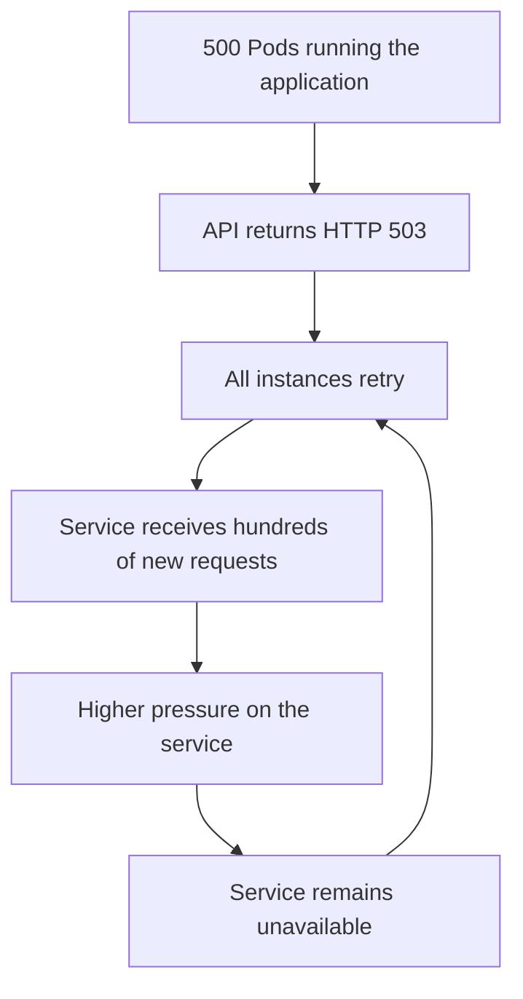
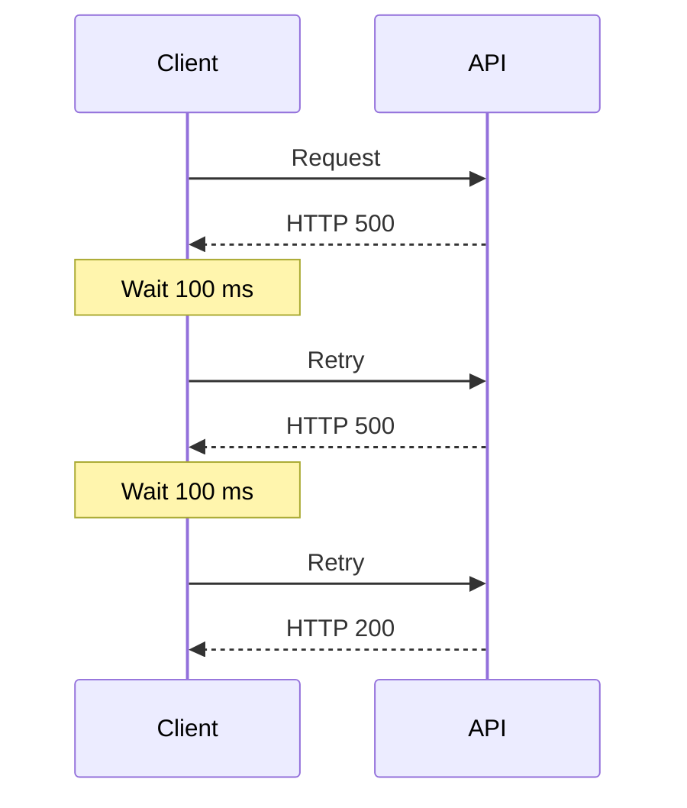

<Image
  alt={`Stressed man`}
  src={`/images/resiliency-why-retries-can-bring-down-your-system/stressed-man.png`}
  layout="fill"
  className="!relative"
/>

In distributed architectures, failures are inevitable. APIs go down, brokers stop responding, databases degrade, and network failures interrupt communication between services. The question is not whether these failures will happen, but how our applications will react to them.

## When does retry make the problem worse?

At first glance, repeating an operation after a failure seems like a safe strategy. After all, if the problem is temporary, you can just try again. However, in distributed systems, this approach can produce the opposite effect, increasing the pressure on an already degraded service.

Imagine an environment running approximately 500 application instances. At some point, an external API starts returning HTTP 503 (Service Unavailable). All instances detect the failure and immediately retry the communication. In just a few milliseconds, the service that was already unavailable receives another 500 requests. Since it is still down, more retries are triggered, quickly pushing the request volume into the thousands per second. Instead of helping the service recover, the clients begin to amplify its unavailability.

Now imagine an environment with thousands of instances spread across different regions or availability zones. The impact is no longer isolated and starts affecting the entire infrastructure responsible for serving that operation.

Retry by itself does not make a system more resilient. When used naively, it can amplify an existing failure, creating what is known as a Retry Storm. This behavior creates a feedback loop, where the more unavailable the service becomes, the more retries clients perform.

This behavior can trigger a cascading failure, where the unavailability of a single service starts degrading other components that depend on it, compromising the stability of the architecture as a whole.

## What is retry?

When applied correctly, retry can automatically recover from transient failures without requiring user intervention, increasing the perceived availability of the application. This pattern is extremely common in distributed architectures because communication between services is inherently unstable. These failures can come from connectivity errors, throttling, server failures, among others.

Here we can see how a retry mechanism works visually:

This example uses the Fixed Retry Interval strategy. Although simple, this strategy can cause problems in distributed environments when many instances retry requests at the same time.

In the next articles, we will look at more sophisticated strategies, such as Exponential Backoff and Jitter, which make this process significantly more efficient and reduce the pressure placed on degraded services.

## Transient failures vs permanent failures

It is important to note that there are two types of failures: transient and permanent. Transient failures happen but recover after some time, such as brief network failures, temporary server outages, or rate limiting (HTTP 429), for example. It is worth stressing that not every transient failure should necessarily use retry. Operations with high computational cost, low latency tolerance, or significant side effects may require other resilience strategies.

Permanent failures are failures that happen definitively. Some examples are: missing resource (404), lack of access permission (401/403), or even invalid data sent in a request. In general, these are errors that will keep happening regardless of how many retries are performed. This usually indicates that something must be fixed in the application, configuration, or request authentication.

The table below adds a few more examples of scenarios where retry applies and where it does not:

| Failure type      | Retry? | Reason                               | Example                           |
| ----------------- | :----: | ------------------------------------ | --------------------------------- |
| Timeout           |  Yes   | Temporary failure                    | API took too long to respond      |
| Connection refused |  Yes  | Service unavailable                  | Database unavailable              |
| HTTP 429          |  Yes   | Temporary rate limiting              | Rate limit                        |
| HTTP 502          |  Yes   | Temporary gateway error              | Bad Gateway                       |
| HTTP 503          |  Yes   | Service temporarily unavailable      | Service Unavailable               |
| HTTP 400          |   No   | Invalid request                      | Invalid payload                   |
| HTTP 401          |   No   | Authentication required              | Not authenticated                 |
| HTTP 403          |   No   | Authorization missing                | No permission                     |
| HTTP 404          |   No   | Resource does not exist              | Endpoint or resource not found    |

**Important:** the decision to use retry depends not only on the returned HTTP status code, but also on the nature of the operation and the business rules involved.

## How many retries should we make?

This is an interesting point, and the direct answer is: it depends. There is no universal definition for the number of retries. That decision depends on the criticality of the operation, SLA or SLO requirements, the configured timeout, and the cost of keeping retries running.

The decision usually takes into account factors such as:

- operation criticality
- expected SLA or SLO
- computational cost of the operation
- impact on the user
- capacity of the called service
- likelihood of dependency recovery

## Retry limitations

Besides the benefits of using retry, there are also some points that need to be considered during application design:

- Increased operation latency
- Higher consumption of operational resources
- Risk of a Retry Storm when used incorrectly
- Increased implementation complexity
- Risk of duplicate operations if they are not idempotent

## Idempotency and retry

One of the biggest risks of using retry is duplicate operations. With that in mind, one question must be answered: is it safe to repeat the operation?

Read operations, such as queries (GET), can usually be repeated without worrying about side effects. However, financial operations such as payments, transfers, or order creation can lead to inconsistencies if they are executed more than once.

For this reason, distributed system architectures that use retry need to implement idempotency mechanisms, ensuring that multiple attempts of the same operation produce only one effect, even when executed more than once.

Since this topic deserves a deeper discussion, we will dedicate a specific article in the series to understanding how idempotency complements retry strategies.

## Conclusion

Retry is one of the most important resilience patterns in distributed systems and is present in practically every modern platform. However, using it without an appropriate strategy can turn a temporary failure into an even bigger problem, increasing the pressure on already degraded services.

In the next article, we will see how **Exponential Backoff** solves this problem by progressively increasing the interval between retries, reducing the impact on unavailable systems.

### References
https://blog.bytebytego.com/p/a-guide-to-retry-pattern-in-distributed
https://www.geeksforgeeks.org/system-design/retry-pattern-in-microservices/
https://docs.cloud.google.com/storage/docs/retry-strategy
https://fidelissauro.dev/resiliencia/
https://aws.amazon.com/blogs/architecture/exponential-backoff-and-jitter/
