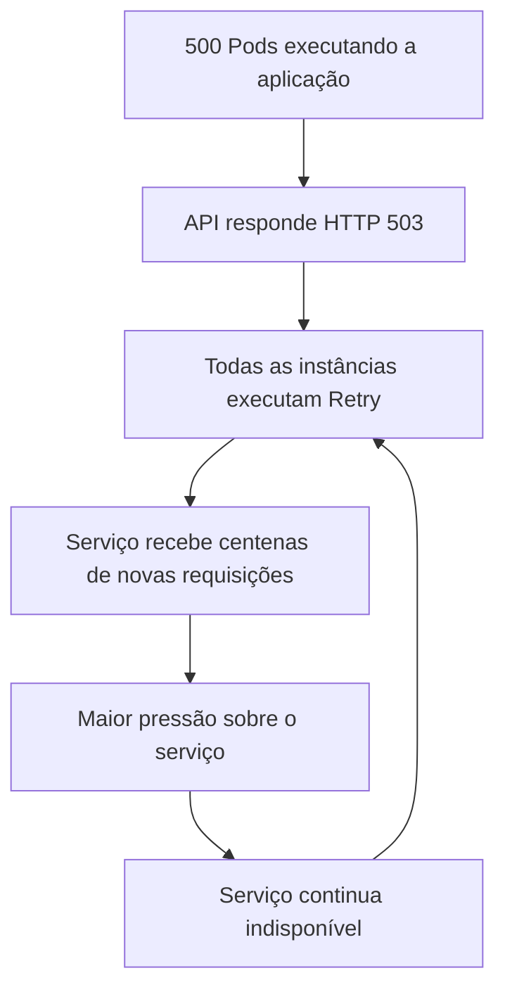
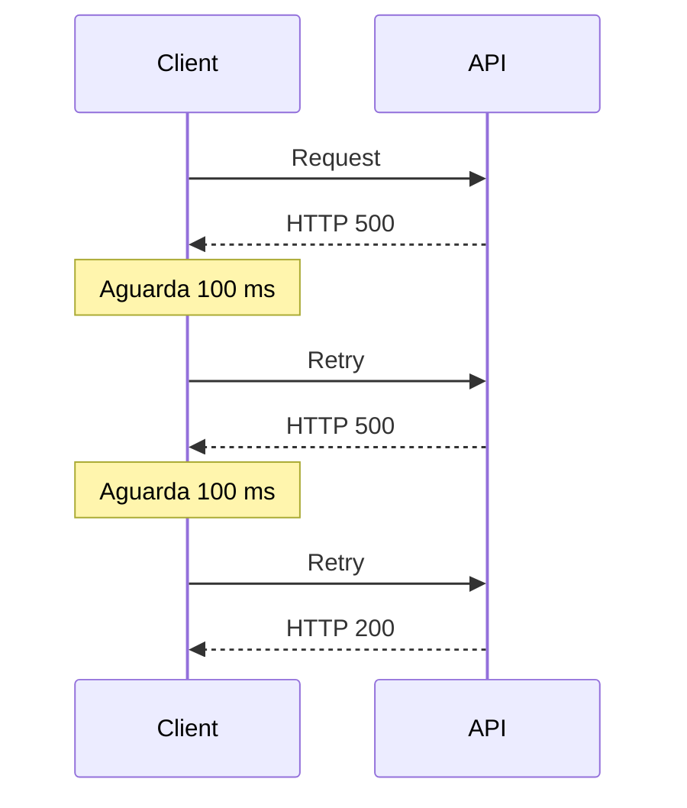

<Image
  alt={`Stressed man`}
  src={`/images/resiliency-why-retries-can-bring-down-your-system/stressed-man.png`}
  layout="fill"
  className="!relative"
/>

Em arquiteturas distribuídas, falhas são inevitáveis. APIs ficam indisponíveis, brokers deixam de responder, bancos de dados sofrem degradação e falhas de rede interrompem a comunicação entre serviços. A questão não é se essas falhas ocorrerão, mas como nossas aplicações irão reagir a elas.

## Quando o Retry piora o problema?

À primeira vista, repetir uma operação após uma falha parece uma estratégia bastante segura. Afinal, se o problema for temporário, basta tentar novamente. Entretanto, em sistemas distribuídos, essa abordagem pode produzir exatamente o efeito contrário, aumentando ainda mais a pressão sobre um serviço já degradado.

Imagine um ambiente executando aproximadamente 500 instâncias da aplicação. Em determinado momento, uma API externa começa a responder HTTP 503 (Service Unavailable). Todas as instâncias detectam a falha e imediatamente fazem uma nova tentativa de comunicação. Em poucos milissegundos, o serviço que já estava indisponível recebe outras 500 requisições. Como continua indisponível, novas tentativas são realizadas, elevando rapidamente o volume de requisições para milhares por segundo. Em vez de ajudar na recuperação do serviço, os clientes passam a amplificar sua indisponibilidade.

Agora imagine um ambiente com milhares de instâncias distribuídas entre diferentes regiões ou zonas de disponibilidade. O impacto deixa de ser pontual e passa a comprometer toda a infraestrutura responsável por atender aquela operação.

O retry por si só não torna um sistema mais resiliente. Quando utilizado de forma ingênua, ele pode amplificar uma falha existente, gerando um efeito conhecido como Retry Storm. Esse comportamento cria um ciclo de retroalimentação (**feedback loop**), onde quanto mais indisponível o serviço fica, maior é a quantidade de novas tentativas realizadas pelos clientes.

Esse comportamento pode provocar um efeito cascata (**cascading failure**), onde a indisponibilidade de um único serviço passa a degradar outros componentes que dependem dele, comprometendo a estabilidade da arquitetura como um todo.

## O que é Retry?

Quando aplicado corretamente, o Retry permite recuperar automaticamente falhas transitórias sem exigir intervenção do usuário, aumentando a disponibilidade percebida da aplicação. O uso desse padrão em arquiteturas distribuídas é extremamente comum devido à natureza instável da comunicação entre serviços. Essas falhas podem ser provenientes de um erro de conectividade, throttling, falha no servidor, entre outros.

Aqui podemos ver como funciona um mecanismo de retry de maneira visual:

Esse exemplo utiliza a estratégia de Fixed Retry Interval (intervalo fixo entre tentativas). Apesar de simples, essa estratégia pode causar problemas em ambientes distribuídos quando muitas instâncias repetem requisições simultaneamente.

Nos próximos artigos veremos estratégias mais sofisticadas, como Exponential Backoff e Jitter, que tornam esse processo significativamente mais eficiente, reduzindo a pressão exercida sobre serviços degradados.

## Falhas transitórias x Falhas permanentes

Importante perceber que existem dois tipos de falhas, as transitórias e as permanentes. Falhas transitórias são falhas que acontecem, mas se restabelecem após um certo período de tempo, como falhas rápidas de rede, queda momentânea de servidor, ou limitação de taxa (HTTP 429) por exemplo. Vale ressaltar que nem toda falha transitória deve necessariamente utilizar Retry. Operações com alto custo computacional, baixa tolerância à latência ou efeitos colaterais relevantes podem exigir outras estratégias de resiliência.

Falhas permanentes são falhas que acontecem de maneira definitiva, algumas delas são: recurso inexistente (404), falta de permissão de acesso (401/403), ou até mesmo dados inválidos enviados em alguma requisição. Em geral, são erros que continuarão acontecendo independentemente do número de tentativas realizadas. Isso normalmente indica a necessidade de correção na aplicação, na configuração ou na autenticação da requisição.

Na tabela abaixo adiciono mais alguns exemplos de cenários onde se aplicam e não se aplicam o retry:

| Tipo de falha    | Retry? | Motivo                               | Exemplo                            |
| ---------------- | :----: | ------------------------------------ | ---------------------------------- |
| Timeout          |  Sim   | Falha temporária                     | API demorou para responder         |
| Conexão recusada |  Sim   | Serviço indisponível                 | Banco indisponível                 |
| HTTP 429         |  Sim   | Limitação temporária de taxa         | Rate Limit                         |
| HTTP 502         |  Sim   | Erro temporário de gateway           | Bad Gateway                        |
| HTTP 503         |  Sim   | Serviço temporariamente indisponível | Service Unavailable                |
| HTTP 400         |  Não   | Requisição inválida                  | Payload inválido                   |
| HTTP 401         |  Não   | Requer autenticação                  | Não autenticado                    |
| HTTP 403         |  Não   | Falta de autorização                 | Sem permissão                      |
| HTTP 404         |  Não   | Recurso inexistente                  | Endpoint ou recurso não encontrado |

**Importante:** a decisão de utilizar Retry depende não apenas do código HTTP retornado, mas também da natureza da operação executada e das regras de negócio envolvidas.

## Quantas tentativas devemos fazer?

Esse é um ponto interessante, e a resposta direta é: depende. Não existe uma definição universal para a quantidade de tentativas. Essa decisão depende da criticidade da operação, dos requisitos de SLA ou SLO, do tempo de timeout configurado e do custo de manter novas tentativas sendo executadas.

A definição normalmente considera fatores como:

- criticidade da operação
- SLA ou SLO esperado
- custo computacional da operação
- impacto para o usuário
- capacidade do serviço chamado
- probabilidade de recuperação da dependência

## Limitações do Retry

Além dos benefícios do uso de retry, também temos alguns pontos que precisam ser considerados durante o projeto da aplicação:

- Aumento da latência das operações
- Maior consumo de recursos operacionais
- Possibilidade de Retry Storm quando utilizado de forma inadequada
- Aumento da complexidade da implementação
- Risco de duplicação de operações caso elas não sejam idempotentes

## Idempotência e Retry

Um dos maiores riscos da utilização de Retry é a duplicação de operações. Diante disso, uma pergunta precisa ser respondida: repetir a operação é seguro? 

Operações de leitura, como consultas (GET), normalmente podem ser repetidas sem preocupação de efeitos colaterais. No entanto, operações financeiras, como pagamentos, transferências ou criação de pedidos podem gerar inconsistências caso sejam executadas mais de uma vez.

Por esse motivo, em arquiteturas de sistemas distribuídos que utilizam mecanismo de retry precisam implementar mecanismos de idempotência, garantindo que múltiplas tentativas da mesma operação produzam apenas um único efeito, mesmo quando executadas mais de uma vez.

Como esse tema merece uma discussão mais aprofundada, dedicaremos um artigo específico da série para entender como a idempotência complementa estratégias de Retry.

## Conclusão

O Retry é um dos padrões de resiliência mais importantes em sistemas distribuídos e está presente em praticamente todas as plataformas modernas. Entretanto, utilizá-lo sem uma estratégia adequada pode transformar uma falha temporária em um problema ainda maior, aumentando a pressão sobre serviços já degradados.

No próximo artigo veremos como o **Exponential Backoff** resolve esse problema aumentando progressivamente o intervalo entre as tentativas, reduzindo o impacto sobre sistemas indisponíveis.

### Referências
https://blog.bytebytego.com/p/a-guide-to-retry-pattern-in-distributed
https://www.geeksforgeeks.org/system-design/retry-pattern-in-microservices/
https://docs.cloud.google.com/storage/docs/retry-strategy
https://fidelissauro.dev/resiliencia/
https://aws.amazon.com/blogs/architecture/exponential-backoff-and-jitter/
